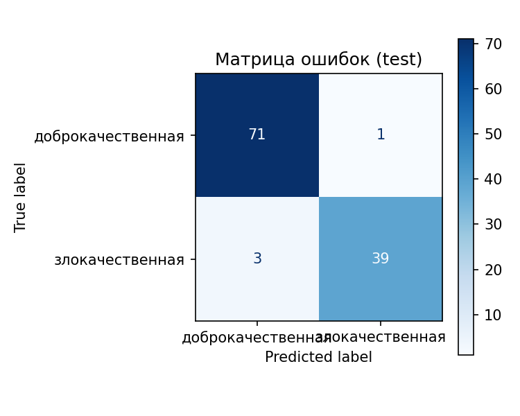
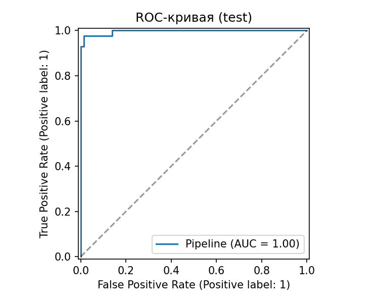
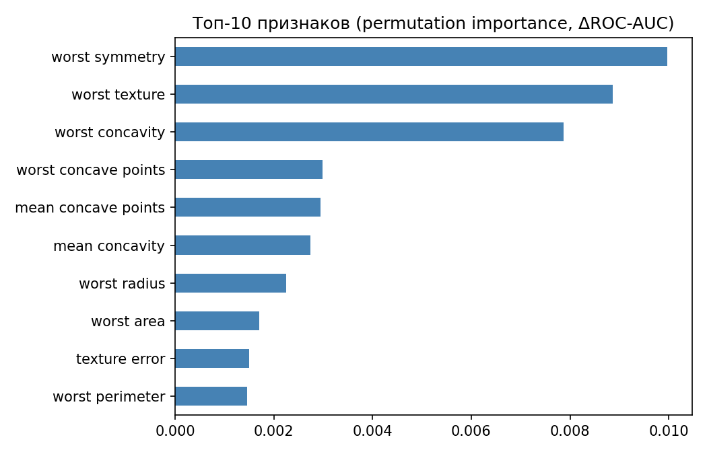

# Классификация опухолей молочной железы (доброкачественная / злокачественная)

Учебный ML-проект: по 30 числовым признакам клеточных ядер (радиус, текстура,
периметр, вогнутость и т. д.) предсказываем, злокачественна ли опухоль.
Полный цикл: загрузка данных → разбиение → сравнение моделей с подбором
гиперпараметров → честная оценка на отложенной выборке → сохранение модели и отчётов.

**Стек:** Python, pandas, scikit-learn, matplotlib, joblib

## Данные

[Wisconsin Diagnostic Breast Cancer](https://scikit-learn.org/stable/modules/generated/sklearn.datasets.load_breast_cancer.html) —
569 объектов, 30 признаков, пропусков нет. Классы: 37,3 % злокачественных, 62,7 % доброкачественных.
Датасет встроен в scikit-learn, скачивать ничего не нужно.

Положительный класс (1) — **злокачественная опухоль**, поэтому recall отвечает на вопрос
«какую долю злокачественных опухолей мы нашли» (в медицине пропуск болезни хуже ложной тревоги).

## Что сделано

1. Стратифицированное разбиение 80 / 20 (train 455, test 114).
2. Baseline — `DummyClassifier`, чтобы было с чем сравнивать.
3. Четыре модели: `LogisticRegression`, `SVC`, `RandomForest`, `GradientBoosting`.
   Масштабирование (`StandardScaler`) стоит внутри `Pipeline`, поэтому при кросс-валидации
   нет утечки данных из валидационных фолдов.
4. Подбор гиперпараметров `GridSearchCV` (5-fold stratified CV, метрика ROC-AUC).
5. Лучшая по CV модель оценивается **один раз** на тесте, который не участвовал в подборе.
6. Сохранение модели (`joblib`), метрик (`json`), таблицы CV и графиков.

## Результаты

| Модель | CV ROC-AUC (train) |
|---|---|
| **LogisticRegression (C=1)** | **0.9958** |
| SVC | 0.9954 |
| GradientBoosting | 0.9933 |
| RandomForest | 0.9890 |

Лучшая модель на отложенной выборке (114 объектов):

| Метрика | Baseline | LogisticRegression |
|---|---|---|
| ROC-AUC | 0.557 | **0.996** |
| Recall (злокачественные) | 0.405 | **0.929** |
| Precision | 0.447 | **0.975** |
| F1 | 0.425 | **0.951** |
| Accuracy | 0.596 | **0.965** |

На тесте пропущено 3 из 42 злокачественных опухолей и одна ложная тревога.
Тестовая выборка маленькая, поэтому при другом `--seed` цифры немного «плавают»;
доверять стоит в первую очередь CV-оценке.

<p>
  
  
</p>


## Структура проекта

```
breast-cancer-classification/
├── src/
│   ├── data.py       # загрузка данных
│   ├── train.py      # обучение, подбор гиперпараметров, оценка, графики
│   ├── predict.py    # предсказания сохранённой моделью
│   └── utils.py
├── reports/          # metrics.json, cv_results.csv, figures/*.png (создаётся при запуске)
├── models/           # best_model.joblib (создаётся при запуске, в git не хранится)
├── requirements.txt
└── README.md
```

## Как запустить

```bash
git clone https://github.com/KutyrevAleksandr/breast-cancer-classification.git
cd breast-cancer-classification

python -m venv .venv
source .venv/bin/activate        # Windows: .venv\Scripts\activate
pip install -r requirements.txt

python -m src.train              # обучение и оценка (около минуты)
python -m src.predict            # демо-предсказания обученной моделью
```

Параметры обучения: `python -m src.train --seed 7 --test-size 0.25 --cv 10`.
Предсказание для своего CSV (те же 30 столбцов): `python -m src.predict --csv my_data.csv`.

## Идеи для развития

- Подобрать порог классификации под целевой recall (например, ≥ 0.98) и показать цену в precision.
- Добавить калибровку вероятностей и SHAP для объяснения отдельных предсказаний.
- Повторить на более сложном датасете с пропусками и категориальными признаками.

> Проект учебный и не является медицинским инструментом.
